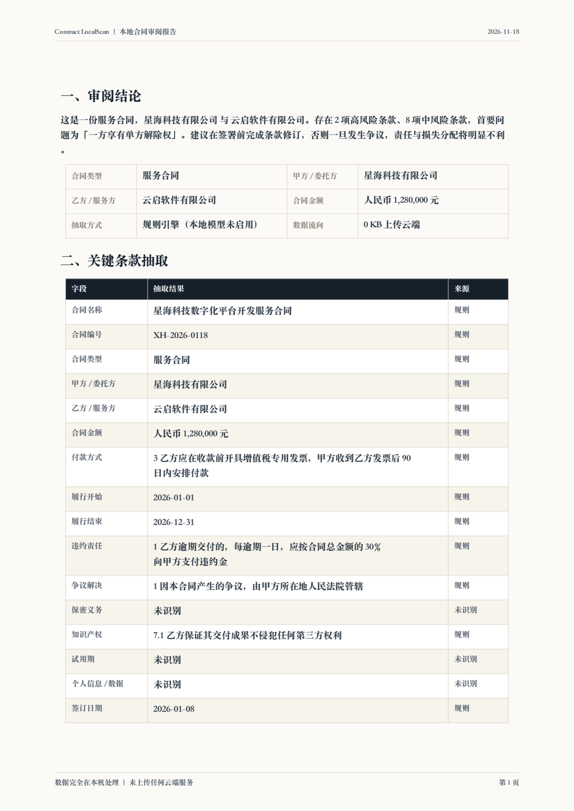
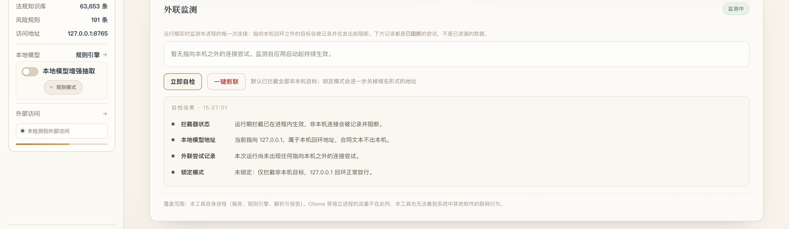

# Contract LocalScan · 本地合同风险审阅

[](https://github.com/LHQCOCO/contract-local-scan-demo/actions/workflows/ci.yml)

把一份合同丢进浏览器，在**完全离线**的本机环境里拿到一份可复核的审阅报告：命中了哪些风险条款、原文证据是哪一句、依据的是哪一条法律、建议怎么改，并导出成 PDF / Word / Excel。


*在 macOS 上跑本仓库代码、审阅 `samples/软件开发服务合同.txt` 的真实结果：18 条命中（2 高 / 8 中 / 8 低），每条风险都给出条款原文、修改建议与可点开的法条；左栏实时显示法库 63,653 条、规则 191 条、监听地址 127.0.0.1。*

**给谁用**：在送律师之前要做一遍初筛的法务、业务和创业者；以及想读「确定性规则 + 本地 BM25 检索 + 运行时断网」这套工程实现的人。

**三分钟验证真假**

1. **看图**：下面三张图都是本仓库代码在本机跑出来的界面与导出件，不是设计稿。
2. **跑测试**：`pip install -r requirements.txt && python -m pytest tests -q` → `385 passed`；CI 在 Ubuntu / macOS 上跑同一套用例。
3. **读代码**：规则 `cls/risks.py`、BM25 `cls/kb.py`（k1=1.45, b=0.72）、断网 `cls/netguard.py`、导出 `cls/reporting.py`。

**运行环境**：Python 3.11 或 3.12；`python app.py` 后打开 <http://127.0.0.1:8765>，法规库索引在数秒内就绪。

## 你会看到什么

| 导出件 | 离线可验证 |
| --- | --- |
|  |  |
| 本机生成的 8 页 PDF 报告：审阅结论、关键字段抽取（每格标注来源）、分等级风险清单与法条原文。同一份结果还能导出带 16 条 Word 原生批注的 DOCX 与 Excel 清单。 | 「系统与隐私 → 外联监测」：运行期拦截所有非回环连接，记录每次被拦截的尝试，支持一键断联。整份报告与知识库都在 127.0.0.1 内完成。 |

---

## 1. 它解决什么问题

合同审阅的现实约束是三条：**条款要看全、依据要能查、内容不能外传**。

- 通用大模型的合同审阅有三个问题：结论不可复现、引用法条经常编造、把合同原文发到云端本身就是合规风险。
- 律所与法务 SaaS 解决得更好，但按份计费，日常的「这份采购合同有没有坑」用不上。
- 真正高频的需求是**初筛**：在送律师之前，先把明显不利的条款、缺失的必备条款、超阈值的数字挑出来，并附上法条依据。

Contract LocalScan 就做这一层：本地进程 + 本机浏览器页面，不联网也能跑；每条结论都带原文证据与法条 id，可点开核对；结果可导出、可入库、可复查。

## 2. 架构与处理流程

```
浏览器（templates/index.html + static/app.js）
        │  上传 PDF / DOCX / TXT（≤25MB，单次多份）
        ▼
Flask 应用 app.py ──► 后台线程逐份处理（前端轮询 /api/jobs/<id> 拿进度）
        │
        ├─ cls/parsing.py      解析：PDF 文本层 → 无文本层则本机 OCR（rapidocr）；DOCX → 段落；TXT
        ├─ cls/extraction.py   抽取：当事人、金额、期限、付款、违约、争议解决、合同类型（关键词候选 + 可选模型消歧）
        ├─ cls/risks.py        规则引擎：191 条规则，match / absence / threshold / check 四种模式，打分分级
        ├─ cls/kb.py           法条检索：自实现 BM25 召回 → 按合同类型路由法域 → 去重后附到每条 finding
        ├─ cls/llm.py          （可选）本机 Ollama：字段抽取补全、条款复核，全部走 127.0.0.1
        └─ cls/reporting.py    导出：PDF（证据句定位到原文段落并加批注）、DOCX（真批注）、XLSX
        │
        ▼
cls/store.py（SQLite 历史记录） + data/ 本地目录
```

运行期还有一层 `cls/netguard.py`：安装 socket 钩子，除 127.0.0.1 / localhost 之外的连接一律拦截并记录。「不联网」不是靠承诺，是靠运行时拦截。

### 规则引擎

- 191 条规则覆盖 25 个类别（劳动、采购、租赁、借款、建设工程、股权、担保、保密、数据与个人信息、刑事风险、跨境合规等），高/中/低三档。
- 四种判定模式：
  - `match`：正则命中不利表述（如「甲方逾期付款不承担任何违约责任」）。
  - `absence`：必备条款缺失判定，用 marker 命中率 40% 作为阈值——全 `all()` 太严会漏检，全 `any()` 会把写得全的合同误判。
  - `threshold`：可参数化阈值（逾期付款天数、违约金比例、试用期工资比例等），阈值存在用户配置里。
  - `check`：需要上下文判断的复合检查（劳动、隐私、数据、行业专项）。
- 评分：`score = min(98, 5 + Σ权重)`，高 16 / 中 8 / 低 3；≥55 高风险，≥28 中风险。
- 支持导入自定义规则包（JSON），与内置规则同条款冲突时标记 `divergence`，两套结论并列而非互相覆盖。

### 知识库

1,480 部法规 / 63,653 条条文（含 CISG、纽约公约、UNCITRAL 示范法、UNIDROIT 通则），条文全文随仓库分发。

## 3. 关键技术选择

### 3.1 为什么用确定性规则打底，而不是让模型直接出结论

1. **可复核**。审阅结论要能拿去和对方谈。「第 6.1 条约定日 30% 违约金，超过《民法典》第 585 条可调整范围」这种结论必须句句可定位；正则命中的证据句天然就是原文切片，模型生成的解释则不是。
2. **可回归**。规则是数据，能写测试、能统计误报。191 条规则对应 385 个测试用例，改一条规则立刻知道影响了哪类合同；换成 prompt，同样的改动只能靠抽样目测。
3. **可解释失败**。模型给不出结论时只能返回「不确定」；规则引擎可以准确说出「缺少争议解决条款」还是「争议解决条款存在但没有约定管辖地」。
4. **成本与确定性**。规则模式零依赖、毫秒级、结果逐字节可复现，适合做成默认路径；模型只在「值得花 10 秒」的环节介入（字段抽取补全、多候选合同类型消歧、高风险条款复核），且失败自动降级回纯规则结果。

### 3.2 为什么自实现 BM25，而不引入向量库

1. **法条检索是术语匹配，不是语义相似**。「违约金过高」需要的是《民法典》第 585 条，靠的是「违约金」这个词和法条标签；向量检索在这里既贵又不准，还容易召回语义相近但适用条件不同的条文。
2. **可解释与可调试**。打分公式是 IDF 加权词频饱和度（k1=1.45, b=0.72），命中哪几个词、覆盖了多少查询词、为什么这条排在前面，全部可算可打印。引入 embedding 后，排序变成一个黑盒，规则调试会立刻失去抓手。
3. **零依赖、零模型文件**。jieba 分词 + 纯 Python 倒排索引，启动即用，不需要下载几百 MB 的模型，也不用担心不同机器的向量模型版本不一致导致结果漂移。
4. **工程化的检索策略比「换检索器」更有效**。当前实现里真正解决问题的是这些：查询侧用 `jieba.cut` 粗粒度分词避免「互联网/互联/联网」重复计分；用 IDF 覆盖率过滤掉只命中停用词的伪召回；按合同类型路由法域（劳动争议只查劳动法域）；单法典结果数封顶，防止《民法典》霸屏。

### 3.3 其他取舍

- **SQLite 而不是 JSON 文件存历史**：需要按时间倒序分页、按 id 删除、统计，文件方案会写成小型数据库。
- **后台线程 + 轮询而不是 WebSocket**：审阅是分钟级以内的短任务，轮询实现简单、断线自愈，不需要维护长连接状态。
- **本地模型只走 127.0.0.1**：`/api/config` 对 Ollama 地址做 host 白名单校验，客户端无法把请求引向外部地址。

## 4. 如何运行

需要 Python 3.11 或 3.12（CI 在 Ubuntu 与 macOS 上覆盖这两个版本）。

```bash
python3 -m venv .venv && source .venv/bin/activate
pip install -r requirements.txt
python app.py           # 或 ./run.sh
```

打开 <http://127.0.0.1:8765>。首次启动会加载法规库并建索引（约数秒）。

可选：本机已安装 [Ollama](https://ollama.com) 并拉了模型时，设置页可开启 AI 辅助；不安装也能完整使用全部规则能力。

示例合同在 `samples/`（服务合同 TXT、采购框架合同 PDF、劳动合同 DOCX），也可以直接上传自己的文件。

## 5. 评测方法

```bash
python -m pytest tests -q          # 385 个用例
```

测试按能力分层：

| 文件 | 覆盖内容 |
|---|---|
| `tests/test_*_rules.py`（7 个） | 每类合同的规则回归：触发、不触发、证据句、法条依据是否存在 |
| `tests/test_kb.py` | BM25 检索、法域路由、标签检索、法条计数与知识库完整性 |
| `tests/test_extraction_amount.py` | 金额、日期、主体抽取 |
| `tests/test_custom.py` | 自定义规则导入、阈值规则、坏正则隔离 |
| `tests/test_review_route.py` / `test_docx_route.py` | 上传 → 审阅 → 结果接口的端到端路径 |
| `tests/test_reporting_*.py` | PDF / DOCX / XLSX 导出结构 |
| `tests/test_hardening.py` | 路径穿越、非法文件名、超大文件等安全边界 |
| `tests/test_ocr.py` | 无文本层 PDF 的 OCR 兜底 |
| `tests/test_model_memory_gate.py` | 本机内存不足时拒绝加载大模型 |

CI 在 Ubuntu 与 macOS、Python 3.11/3.12 上跑同一套用例，并额外做一次知识库冒烟（法条总量 + BM25 有返回）。

想手工验证一份合同：上传 `samples/软件开发服务合同.txt`，应至少命中「无预付款 + 验收后 180 日付款」「逾期付款不担责」「日 30% 违约金」「甲方单方任意解除」四类问题，并给出对应法条。

## 6. 已知限制

- **是初筛，不是法律意见**。规则召回偏向「明确不利/明确缺失」的条款，对需要结合交易背景判断的条款（如商业合理性）无能为力。
- **规则是枚举式的**。191 条规则覆盖 25 类常见合同，长尾合同（如涉外工程、衍生品）覆盖有限，缺失的类别需要新增规则。
- **`absence` 模式有取舍**。marker 命中率 40% 的阈值在「合同只截取了部分章节」时会偏保守，宁可漏报也不误报。
- **条款修订建议为占位文本**。`cls/revisions.py` 只保留了接口与索引结构，逐条修订草案尚未撰写，UI 会显示模板文案。
- **OCR 只处理 PDF**。图片型 DOCX 不支持；扫描件识别质量取决于清晰度。
- **单机单用户**。没有账号体系，`127.0.0.1` 绑定 + 本机文件存储，不支持多人并发协作。
- **展示版的数据裁剪**。`data/sources/laws/`（抓取缓存）与 `data/sources/repo/`（LawRefBook 快照）未入库，可用 `scripts/fetch_statutes.py` 重建；完整法库以 4 个分片形式随仓库分发。

## 7. 目录结构

```
app.py                  Flask 应用：路由、任务队列、审阅流水线编排
cls/
  parsing.py            PDF / DOCX / TXT 解析与 OCR 兜底
  extraction.py         关键字段抽取、合同类型判定
  risks.py              规则引擎（191 条内置规则 + 自定义规则）
  revisions.py          条款修订草案索引（当前为占位结构）
  kb.py                 BM25 检索、法域路由、查询扩展
  llm.py                本机 Ollama 可选能力
  netguard.py           运行期外联拦截
  reporting.py          PDF / DOCX / XLSX 导出与原文定位
  store.py              SQLite 历史记录
  custom.py             自定义规则包导入与校验
  config.py             路径、配置读写
templates/ static/      前端页面
data/statutes*.json     法规库（statutes_extra_1..4.json 为完整法库分片）
data/sources/           构建法规库用的原文（民法典、刑法等）与国际条约 PDF
samples/                示例合同
tests/                  385 个用例
scripts/
  build_kb.py           从 data/sources/*.txt 构建核心法库
  fetch_statutes.py     抓取扩充法库（生成 37MB 中间文件）
  split_statutes.py     把中间文件切成 <15MB 分片
  build_intl.py         CISG / 纽约公约 / 示范法
  build_upicc.py        UNIDROIT 通则
  sync_public.py        从私有源重建本仓库（见下）
  showcase/             展示版补丁与 CI 配置
```

## 8. 维护：如何更新这个展示仓

展示仓不手工维护副本。`scripts/sync_public.py` 会把私有源重新剥离、切片、打补丁、自检，再同步过来：

```bash
python scripts/sync_public.py --dry-run          # 只构建 + 自检，不落盘
python scripts/sync_public.py                    # 同步到工作区，人工 review 后自行提交
python scripts/sync_public.py --commit "发布 v1.1.3 展示版" --push
```

剥离规则（`STRIP_DIRS` / `STRIP_FILES`）与代码补丁（`scripts/showcase/patches/`）都在仓库里，可审计、可修改。私有源码若改动了补丁涉及的位置，脚本会直接失败并提示重建补丁，不会静默漏掉授权代码。

## 9. 关于本展示仓

- 代码与法规数据来自完整产品 Contract LocalScan 1.1.2，已剥离授权校验（`cls/license.py`）、渠道与打包配置、密钥占位和运行期数据；除此之外，审阅规则引擎、检索、解析、导出与 385 条测试均为生产代码。
- 截图取自 macOS 上运行本仓库代码的实际界面与导出件，示例合同为虚构主体。
- 本仓库只用于展示，不提供安装包与商业授权。

