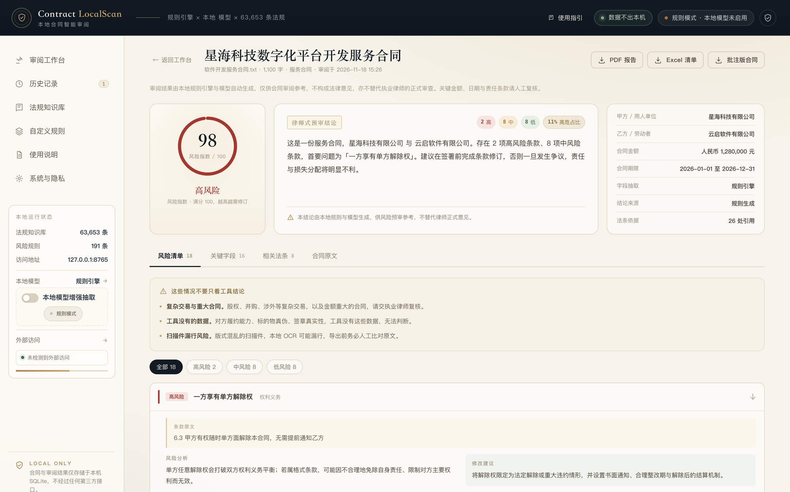

# Contract LocalScan

[](https://github.com/LHQCOCO/contract-local-scan-demo/actions/workflows/ci.yml)

Contract LocalScan 是一个在本地运行的合同初审工具。在浏览器里拖入或选择 PDF、Word、TXT 合同，它会列出命中的风险条款、条款原文、对应法条和修改建议，并导出 PDF、Word、Excel。审阅过程不需要联网。



上图是在 macOS 上运行本仓库代码，审阅 `samples/软件开发服务合同.txt` 的结果：18 条命中，其中高风险 2 条、中风险 8 条、低风险 8 条。

## 它能做什么

- 读取 PDF、DOCX、TXT。单份不超过 25 MB，单次最多 8 份。没有文本层的 PDF 走本机 OCR，单份最多识别 30 页。
- 用 191 条规则覆盖 26 个规则类别，按 `match`、`absence`、`threshold`、`check` 四种模式判定，输出高、中、低三档。
- 从本地法规库检索法条：1,480 部法规、63,653 条条文，使用 BM25 召回，按合同类型路由法域，每条命中附带法条 id。
- 运行期拦截非回环网络连接并记录每次尝试，报告与知识库都在本机完成。
- 导出 PDF、DOCX、XLSX。DOCX 使用 Word 原生批注。
- 审阅历史存在本机 SQLite。可选接入本机 Ollama，用于字段补全和条款复核。

## 快速开始

环境：

- Python 3.11 或 3.12。
- 本仓库在 macOS 上运行并截图。CI 在 Ubuntu 上跑测试套件，覆盖 Python 3.11 和 3.12。Windows 未纳入 CI。

安装与运行：

```bash
python3 -m venv .venv
source .venv/bin/activate
pip install -r requirements.txt
python app.py
```

也可以执行 `./run.sh`。该脚本会检查依赖，缺依赖时执行 `pip install -r requirements.txt`，然后启动服务。

打开 <http://127.0.0.1:8765>。首次启动会加载法规库并建立索引，完成后进入工作台。索引构建耗时取决于机器配置，这里不给出固定秒数。

测试需要额外安装 `pytest`（未写入 `requirements.txt`，CI 单独安装）：

```bash
pip install pytest
python -m pytest tests -q
```

当前为 385 个用例；CI 在 Python 3.11 和 3.12 上运行同一套用例，并额外做一次知识库冒烟检查（法条总量与 BM25 是否有返回）。

## 用法

1. 打开页面，拖入或选择合同文件。
2. 等待解析、字段抽取、规则匹配和法条检索完成，页面进入结果页。
3. 结果页左侧显示本机运行状态，包括法库条数、规则条数和监听地址；右侧按等级列出命中，每条包含条款原文、风险分析、修改建议和法条依据。
4. 在结果页导出 PDF、DOCX 或 XLSX。

以 `samples/软件开发服务合同.txt` 为例，上传后应得到 18 条命中（高 2、中 8、低 8），并至少包含以下四类问题：

- 无预付款，验收后 180 日付款
- 逾期付款不担责
- 日 30% 违约金
- 甲方单方任意解除


示例合同导出的 PDF 共 8 页，包含审阅结论、关键字段（每格标注来源）、风险清单与法条原文。同一份结果可以导出为带 16 条 Word 原生批注的 DOCX，以及 Excel 清单。


「系统与隐私 → 外联监测」列出运行期拦下的非回环连接，并提供一键断联。

## 工作原理

```
浏览器（templates/index.html + static/app.js）
        │  上传 PDF / DOCX / TXT（≤25MB，单次多份）
        ▼
Flask 应用 app.py ──► 后台线程逐份处理（前端轮询 /api/jobs/<id> 拿进度）
        │
        ├─ cls/parsing.py      解析：PDF 文本层 → 无文本层则本机 OCR（rapidocr）；DOCX → 段落；TXT
        ├─ cls/extraction.py   抽取：当事人、金额、期限、付款、违约、争议解决、合同类型（关键词候选 + 可选模型消歧）
        ├─ cls/risks.py        规则引擎：191 条规则，match / absence / threshold / check 四种模式，打分分级
        ├─ cls/kb.py           法条检索：自实现 BM25 召回 → 按合同类型路由法域 → 去重后附到每条 finding
        ├─ cls/llm.py          （可选）本机 Ollama：字段抽取补全、条款复核，全部走 127.0.0.1
        └─ cls/reporting.py    导出：PDF（证据句定位到原文段落并加批注）、DOCX（真批注）、XLSX
        │
        ▼
cls/store.py（SQLite 历史记录） + data/ 本地目录
```

### 规则引擎

规则共 191 条，分属 26 个类别，覆盖劳动、采购、租赁、借款、建设工程、股权、担保、保密、数据与个人信息、刑事风险、跨境合规等。四种判定模式：

- `match`：用正则匹配不利表述，例如「甲方逾期付款不承担任何违约责任」。
- `absence`：判断必备条款是否缺失，用 marker 命中率 40% 作为阈值。
- `threshold`：可参数化阈值，例如逾期付款天数、违约金比例、试用期工资比例，阈值存在用户配置里。
- `check`：需要上下文的复合检查，用于劳动、隐私、数据和行业专项。

评分公式为 `score = min(98, 5 + Σ权重)`，高权重 16、中权重 8、低权重 3；`score ≥ 55` 判为高风险，`≥ 28` 判为中风险。规则与检索结果由固定规则和本地索引计算，相同输入与相同规则版本下结果一致；导出的 PDF、DOCX 文件包含生成时间等元数据，文件字节不保证一致。

支持导入自定义规则包（JSON）。自定义规则与内置规则在同一条款上冲突时标记 `divergence`，两套结论并列保留。

### 法条检索

法规库包含 1,480 部法规、63,653 条条文，条文全文随仓库分发。检索使用自实现的 BM25（`k1=1.45`，`b=0.72`）加 `jieba` 分词构建倒排索引，查询时按合同类型路由法域，例如劳动争议只查劳动法域；单法典结果数设上限，避免《民法典》占满结果。排序依据是查询词覆盖与 IDF 加权词频，命中词和得分可以打印核对。

### 外联拦截

`cls/netguard.py` 安装 socket 钩子，除 `127.0.0.1` 和 `localhost` 之外的连接一律拦截并记录。拦截记录显示在「系统与隐私 → 外联监测」。

## 项目结构

```
app.py                  Flask 应用：路由、任务队列、审阅流水线编排
cls/
  parsing.py            PDF / DOCX / TXT 解析与 OCR 兜底
  ocr.py                扫描件 PDF 的本地 OCR（单份最多 30 页）
  extraction.py         关键字段抽取、合同类型判定
  risks.py              规则引擎（191 条内置规则 + 自定义规则）
  revisions.py          条款修订草案索引（当前为占位结构）
  kb.py                 BM25 检索、法域路由、查询扩展
  llm.py                本机 Ollama 可选能力
  netguard.py           运行期外联拦截
  reporting.py          PDF / DOCX / XLSX 导出与原文定位
  store.py              SQLite 历史记录
  custom.py             自定义规则包导入与校验
  config.py             路径、配置读写
templates/ static/      前端页面
docs/                   README 使用的三张截图
samples/                示例合同（TXT / PDF / DOCX 各一份）
tests/                  385 个用例，19 个测试文件
data/statutes*.json     法规库（statutes_extra_1..4.json 为完整法库分片）
data/sources/           构建法规库用的原文（民法典、刑法等）与国际条约 PDF
scripts/
  build_kb.py           从 data/sources/*.txt 构建核心法库
  fetch_statutes.py     抓取扩充法库（生成 37MB 中间文件）
  split_statutes.py     把中间文件切成 <15MB 分片
  build_intl.py         CISG / 纽约公约 / 示范法
  build_upicc.py        UNIDROIT 通则
  sync_public.py        从私有源重建本仓库（见「维护者说明」）
  showcase/             展示版补丁与 CI 配置
requirements.txt        运行依赖（版本下限，未锁定；pytest 由使用者或 CI 单独安装）
run.sh                  依赖检查与启动脚本
THIRD_PARTY_NOTICES.md  第三方组件与法条文本声明
.github/workflows/ci.yml  CI 配置
```

## 已知限制

- 这是初筛，不是法律意见。规则召回偏向「明确不利」或「明确缺失」的条款，对需要结合交易背景判断的条款没有覆盖。
- 规则是枚举式的。191 条规则覆盖 26 个类别，长尾合同（如涉外工程、衍生品）覆盖有限，缺失类别需要新增规则。
- `absence` 模式有取舍。marker 命中率 40% 的阈值在合同只截取部分章节时会偏保守，宁可漏报也不误报。
- 条款修订建议为占位文本。`cls/revisions.py` 只保留接口与索引结构，逐条修订草案尚未撰写，界面显示模板文案。
- OCR 只处理 PDF。图片型 DOCX 不支持；单份 PDF 最多识别 30 页，超出部分不识别，需要拆分后分别上传；识别质量取决于扫描清晰度。
- 单机单用户。没有账号体系，服务绑定 `127.0.0.1`，数据存在本机，不支持多人并发协作。
- 依赖版本未锁定。`requirements.txt` 使用 `>=` 下限，不同时间安装可能得到不同版本。
- Windows 未纳入 CI，本仓库只在 macOS 上运行验证过，测试在 Ubuntu 上执行。
- 展示版对数据做了裁剪。`data/sources/laws/`（抓取缓存）与 `data/sources/repo/`（LawRefBook 快照）未入库，可用 `scripts/fetch_statutes.py` 重建；完整法库以 4 个分片形式随仓库分发。
- 许可限制。源码仅用于作品展示，保留所有权利，不授权复用、修改或二次开发，详见「许可与第三方声明」。

## 数字与出处

| 数字 | 值 | 出处与核对方式 | 口径 |
|---|---|---|---|
| 内置规则 | 191 条 | `python -c "import cls.risks as r; print(len(r.RULES))"` | 当前代码中的内置规则，不含用户导入的自定义规则包 |
| 规则类别 | 26 个 | 同一命令，对 `RULES` 的 `category` 去重计数 | 规则自身的类别字段，不等同于合同类型数 |
| 法规 | 1,480 部 | 7 个 `data/statutes*.json` 中 `laws` 数量之和 | 含国内法规、国际条约与示范法 |
| 法条 | 63,653 条 | 同一批文件中 `total` 字段之和 | 随仓库分发的法库快照 |
| 自动化用例 | 385 个 | `python -m pytest tests --collect-only -q` | 当前 `tests/` 目录的收集结果 |
| 单份大小上限 | 25 MB | `cls/parsing.py` 中的 `MAX_BYTES` | 解析层限制 |
| 单次文件数上限 | 8 份 | `app.py` 中的 `MAX_FILES` | 后端兜底，前端同步限制 |
| OCR 页数上限 | 30 页 | `cls/ocr.py` 中的 `OCR_MAX_PAGES` | 单个扫描件 PDF |
| 抽取字段 | 16 个 | `cls/extraction.py` 中的 `FIELD_SPEC` 项数 | 字段清单，不是每条合同都能抽全 |
| 示例命中 | 18 条（高 2 / 中 8 / 低 8） | 审阅 `samples/软件开发服务合同.txt` | 示例合同与当前规则版本的结果，规则调整后会变化 |
| 示例 PDF | 8 页 | 同一结果经 `cls/reporting.py` 的 `build_pdf` 导出 | 示例合同导出结果，页数随字体与内容变化 |
| 示例 DOCX 批注 | 16 条 | 同一结果经 `build_docx` 导出，统计 `word/comments.xml` | 18 条命中中 2 条为缺失类判定，没有原文证据句，不生成批注 |

## 许可与第三方声明

本仓库源码仅用于作品展示，保留所有权利。没有使用 MIT、Apache-2.0 或其他开源许可证，也不授权复制、修改、分发或商业使用。

第三方组件、字体与法条文本的来源和许可，见 [THIRD_PARTY_NOTICES.md](THIRD_PARTY_NOTICES.md)。

## 维护者说明

这一节记录本仓库的维护流程，不属于公开使用方式。

展示仓不手工维护副本。`scripts/sync_public.py` 从私有源重新剥离、切片、打补丁、自检，再同步过来。该脚本需要私有源，公开仓的读者无法执行：

```bash
python scripts/sync_public.py --dry-run          # 只构建 + 自检，不落盘
python scripts/sync_public.py                    # 同步到工作区，人工 review 后自行提交
python scripts/sync_public.py --commit "发布 v1.1.3 展示版" --push
```

剥离规则（`STRIP_DIRS` / `STRIP_FILES`）与代码补丁（`scripts/showcase/patches/`）都在仓库里。私有源码若改动了补丁涉及的位置，脚本会直接失败并提示重建补丁。
